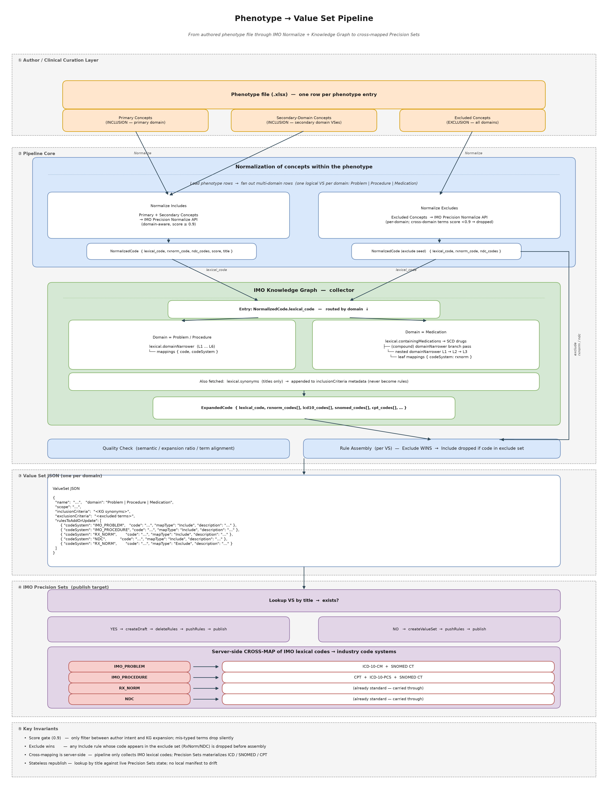
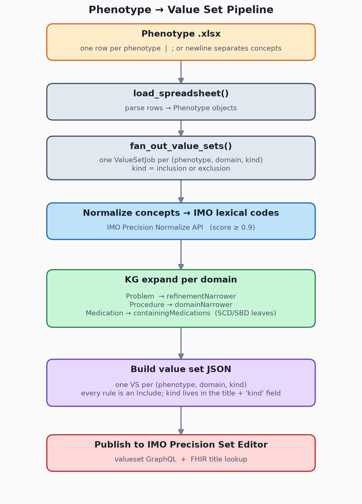

# Phenotype → Value Set Pipeline (Prototype)

Generates IMO Precision Sets value sets from a phenotype spreadsheet. The
pipeline is self-contained in this folder.

## Conceptual architecture



## Pipeline flow



Regenerate the flow diagram with `python make_flow_diagram.py` after editing
pipeline steps.

## Input spreadsheet

The first row is the header (case-insensitive). Required columns:

| Column | Description |
|---|---|
| `phenotype_title` | Value set title |
| `primary_domain` | Domain for `primary_concepts` |
| `primary_concepts` | Primary inclusion concepts |
| `secondary_domain` | Optional second domain |
| `secondary_concepts` | Inclusion concepts for `secondary_domain` |
| `exclusion_concepts_domain` | Domain to which exclusions apply; blank or `All` applies them to every generated domain |
| `exclusion_concepts` | Concepts to exclude |

Multi-value cells use `;`, newline, or `|` to separate concepts.

### Supported domains

| Spreadsheet label | Pipeline domain | KG expansion |
|---|---|---|
| `Condition`, `Problem` | Problem | `refinementNarrower` |
| `Procedure`, `Procedure: Diagnostic (Tests)`, `Procedure: Therapeutic` | Procedure | `domainNarrower` |
| `Medication`, `Vaccine` | Medication | `containingMedications` → SCD/SBD |

Each phenotype produces separate value sets for its inclusion and exclusion
concepts, and Precision Set Editor does not allow a value set to span multiple
domains, so concepts are also split by domain:

* `<phenotype_title>_<domain>_inclusion` — all primary + secondary concepts
  that share this `domain`.
* `<phenotype_title>_<domain>_exclusion` — exclusion concepts, one VS per
  domain they apply to.

When `exclusion_concepts_domain` names a specific domain, only that domain's
exclusion VS is created. When the cell is blank or `All`, an exclusion VS is
generated for every inclusion domain the phenotype has. Primary and secondary
concepts that resolve to the same pipeline domain are combined into one
inclusion VS. Every rule in both the inclusion and the exclusion VS is an
`Include` rule — "exclusion" is encoded in the VS name and the JSON's `kind`
field, not in the rule mapType.

### Value set code systems

The server-side cross-map materializes industry code systems from the lexical
codes; the pipeline only writes the lexical rules.

| Domain | Rule code system(s) |
|---|---|
| Problem | `IMO_PROBLEM` (→ ICD-10-CM + SNOMED CT) |
| Procedure | `IMO_PROCEDURE` (→ CPT + ICD-10-PCS + SNOMED CT) |
| Medication | `RX_NORM` (from normalize + KG leaves) + `NDC` (from normalize) |

## Run

Install dependencies:

```bash
pip install -r src/phenotype-vs-pipeline/requirements.txt
```

Required environment variables:

```text
IMO_NORMALIZE_CLIENT_ID
IMO_NORMALIZE_CLIENT_SECRET
IMO_KG_CLIENT_ID
IMO_KG_CLIENT_SECRET
PS_CLIENT_ID
PS_CLIENT_SECRET
```

### Generate JSONs (dry run)

```bash
python src/phenotype-vs-pipeline/app.py --input phenotypes.xlsx
```

A sample spreadsheet is included at
[`sample/sample_phenotypes.xlsx`](sample/sample_phenotypes.xlsx):

```bash
python src/phenotype-vs-pipeline/app.py --input src/phenotype-vs-pipeline/sample/sample_phenotypes.xlsx
```

### Publish to Precision Sets

```bash
python src/phenotype-vs-pipeline/app.py --input phenotypes.xlsx --publish
```

### Republish existing + publish new

```bash
python src/phenotype-vs-pipeline/app.py --input phenotypes.xlsx --republish
```

Existing value sets are looked up by title inside the pipeline's scope prefix
(`Phenotype Value Set`); a new draft is created, stale rules are removed, the
new rules are pushed, the expansion runs, and the version is published.

### Publish existing JSONs without regenerating

Use after a prior dry run when you want to push the reviewed `valueset_jsons/`
tree straight to Precision Sets without re-hitting Normalize + KG:

```bash
python src/phenotype-vs-pipeline/app.py --publish-only --output ./phenotype_output
python src/phenotype-vs-pipeline/app.py --publish-only --republish --output ./phenotype_output
```

`--input` isn't needed in this mode — the JSONs under
`<output>/valueset_jsons/` are the source of truth. Pair with `--republish`
to draft + update rules on already-published value sets.

### Optional flags

| Flag | Purpose |
|---|---|
| `--output <dir>` | Override the output directory (default: `config.OUTPUT_DIR`) |
| `--sheet <name>` | Select a worksheet by name (defaults to the active worksheet) |
| `--publish-only` | Publish existing JSONs under `<output>/valueset_jsons/` without regenerating; combine with `--republish` for draft-and-update semantics |

## Output

```
<output_dir>/
├── valueset_jsons/                      # one JSON per value set
│   └── <sanitized_title>.json
└── phenotype_YYYYMMDD_HHMMSS.log        # full pipeline log
```

Each JSON follows this contract:

```json
{
  "name": "Type 2 Diabetes_Problem_inclusion",
  "domain": "Problem",
  "scope": "Phenotype Value Set - Type 2 Diabetes_Problem_inclusion, version=2.26.10.1",
  "kind": "inclusion",
  "inclusionCriteria": "type 2 diabetes mellitus; T2DM; NIDDM",
  "exclusionCriteria": "",
  "totalUniqueCodes": 112,
  "rulesToAddOrUpdate": [
    {"codeSystem": "IMO_PROBLEM", "code": "...", "mapType": "Include", "description": "..."}
  ]
}
```

## Files

```
phenotype-vs-pipeline/
├── app.py                        # Pipeline + spreadsheet loader + CLI
├── api_client.py                 # IMO Normalize + Knowledge Graph client
├── precision_sets.py             # IMO Precision Sets publish/republish client
├── config.py                     # Scope prefix, domain map, credentials
├── make_flow_diagram.py          # Regenerates pipeline_flow.png
├── ARCHITECTURE_DIAGRAM.png      # Conceptual architecture
├── pipeline_flow.png             # Step-by-step pipeline flow
├── requirements.txt
├── README.md
└── sample/
    └── sample_phenotypes.xlsx    # Example input covering single/multi-domain + exclusions
```

## Notes

* Prototype — not deployed on ECS/Glue. Runs locally.
* Normalize score threshold is `0.9`; below that a concept is dropped with a log
  message.
* Inclusion and exclusion value sets are fully independent — the pipeline does
  not cross-reference them or filter inclusion codes against exclusion codes.
  Downstream consumers compose the two VSes however they need.
* Scope prefix is `Phenotype Value Set`, used by the FHIR title lookup to
  identify value sets this pipeline owns.
